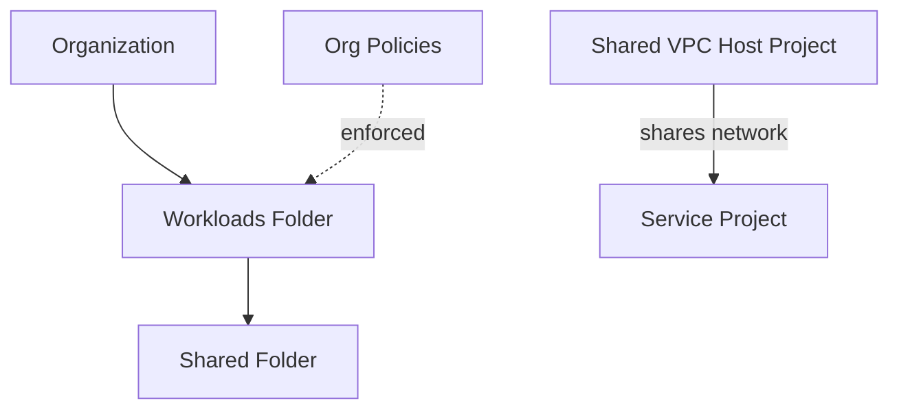

# GCP Secure Landing Zone (Terraform)

> Foundational governance on Google Cloud: a folder hierarchy, organization-policy guardrails, and Shared VPC — provisioned with Terraform.
> **Author:** Muhammad Ahmad · **IaC:** Terraform · **Cloud:** GCP


---

## 📌 Overview

- A **folder hierarchy** (`workloads` → `shared`) to group projects by purpose.
- **Organization policies** on the workloads folder: disable service-account key creation and restrict resource locations to the US.
- **Shared VPC** — a host project shares its network with a service project, centralizing networking.

The governance baseline you lay down before onboarding workload projects.

## 🏗️ Architecture

> 🎨 **Interactive diagram (industry-standard icons):** [open in Lucid — page 28](https://lucid.app/lucidchart/3da75ce3-ea66-4296-81b3-00d20a60435b/edit)



## ⚠️ Prerequisites

Run with an identity that has **Organization Policy Administrator**, **Folder Admin**, and **Compute Shared VPC Admin**. Set `org_id`, `host_project_id`, and `service_project_id`.

## 🚀 Deploy

```bash
cd terraform
gcloud auth application-default login
terraform init
terraform apply \
  -var="org_id=YOUR_ORG_ID" \
  -var="host_project_id=HOST_PROJECT" \
  -var="service_project_id=SERVICE_PROJECT"
```

## 🧹 Clean up

```bash
terraform destroy
```

## 🔐 Production hardening (next steps)

- Add a full folder tree (prod / non-prod / sandbox) with per-folder policies.
- Add **VPC Service Controls** perimeters.
- Centralize **logging** to a dedicated project sink.

---

*Built and maintained by **Muhammad Ahmad**.*
