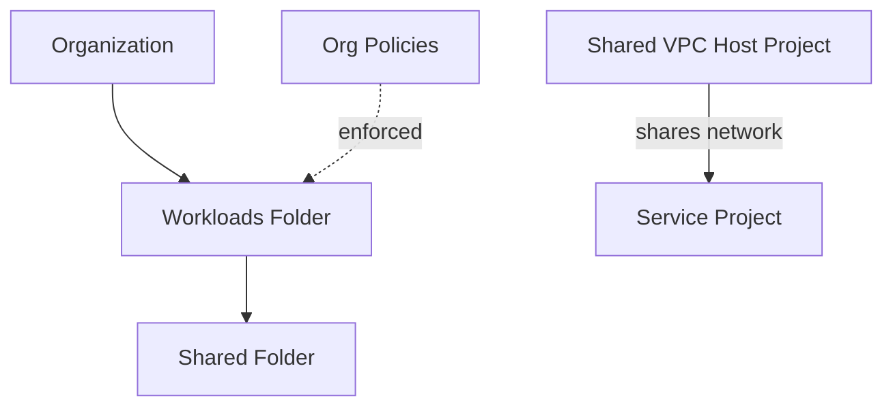

# Architecture Diagram — GCP Secure Landing Zone

## Lucid diagram

- **Master Lucid document (all 30 diagrams, icon style):** https://lucid.app/lucidchart/3da75ce3-ea66-4296-81b3-00d20a60435b/edit
- This project is **page 28** of that document.

## Lucid prompt (reusable)

```
Create a GCP governance diagram titled "GCP Secure Landing Zone".
An Organization contains a Workloads Folder, which contains a Shared Folder. Org
Policies are enforced on the Workloads Folder. Separately, a Shared VPC Host Project
shares its network with a Service Project. Label the arrows. Clean, professional
Google Cloud colors.
```

## Mermaid source


