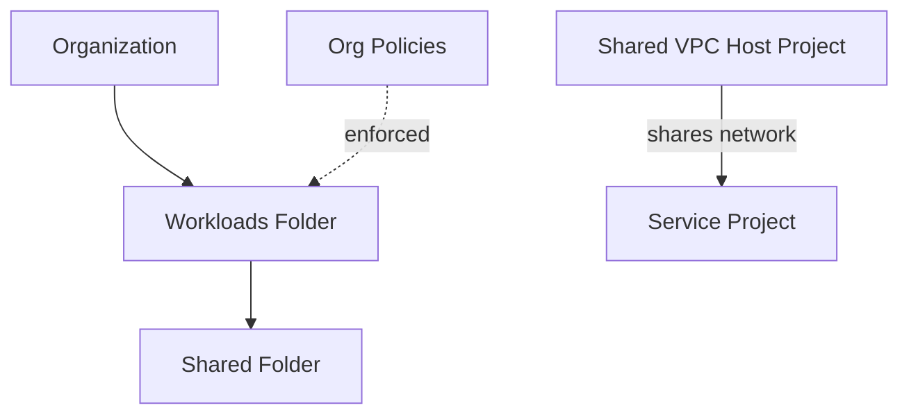

# Architecture Diagram — GCP Secure Landing Zone

## Lucid diagram

- **View:** https://lucid.app/lucidchart/006482b7-be07-40e0-a2bb-948ddfd597d9/view
- **Edit:** https://lucid.app/lucidchart/006482b7-be07-40e0-a2bb-948ddfd597d9/edit

## Lucid prompt (reusable)

```
Create a GCP governance diagram titled "GCP Secure Landing Zone".
An Organization contains a Workloads Folder, which contains a Shared Folder. Org
Policies are enforced on the Workloads Folder. Separately, a Shared VPC Host Project
shares its network with a Service Project. Label the arrows. Clean, professional
Google Cloud colors.
```

## Mermaid source


